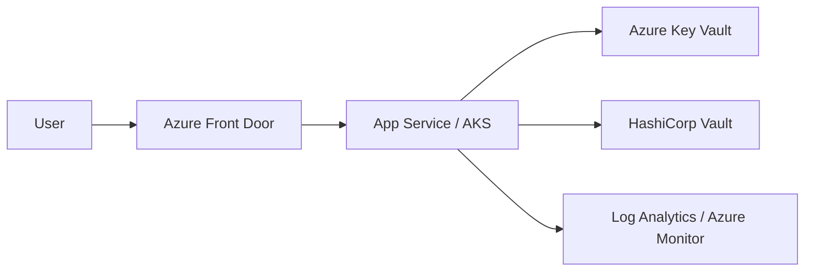

# Azure Secure DevOps Platform

A demo platform that shows how I build secure, automated Azure infrastructure — the same patterns I use day to day: Terraform modules, AKS, Front Door, Key Vault, HashiCorp Vault, and GitHub Actions CI/CD.

> **Demo only.** This is a portfolio project. It contains no employer code, no real secrets, no subscription IDs, and no internal names. Everything here is generic and safe to run in your own Azure subscription.

## What it builds



- **Front Door** in front of App Service, with managed rules and IP restrictions
- **AKS** with a demo app, ingress, health checks, and resource limits
- **Key Vault** for Azure-native secrets, with RBAC (no access policies)
- **HashiCorp Vault** policies and dynamic-secrets examples (dev Vault only)
- **GitHub Actions**: Terraform plan on PR, apply on merge, `tfsec` scan, Docker build

## Tech stack

Terraform · Azure (AKS, Front Door, App Service, Key Vault, VNet, Log Analytics) · Kubernetes / Helm · Docker · HashiCorp Vault · GitHub Actions · PowerShell · Python

## Quick start

```bash
# 1. Prereqs: Azure CLI, Terraform >= 1.5, kubectl, Docker
az login

# 2. Configure (copy the example, fill in YOUR values — never commit the real one)
cp terraform/terraform.tfvars.example terraform/terraform.tfvars

# 3. Deploy the platform
cd terraform
terraform init
terraform plan
terraform apply

# 4. Deploy the demo app to AKS
kubectl apply -f k8s/

# 5. Tear it down when you're done — AKS + Front Door cost money
terraform destroy
```

## Repo layout

| Path | What it is |
| --- | --- |
| `terraform/` | Root module + reusable modules (`aks`, `keyvault`, `frontdoor`, `appservice`, `vnet`, `log-analytics`) |
| `app/` | Tiny demo web app, Dockerized |
| `k8s/` | Kubernetes manifests for the demo app |
| `helm/` | Helm chart for the demo app |
| `.github/workflows/` | Terraform CI/CD + Docker build |
| `vault/` | Vault policies, KV + database dynamic-secrets examples |
| `monitoring/` | Log Analytics queries, Azure Monitor alerts |
| `scripts/` | Service-principal secret rotation (PowerShell, generalized) |
| `docs/` | Architecture and security decisions |

## Cost warning

AKS, Front Door, and App Service are **not free**. Run `terraform plan` first, check the resources, and run `terraform destroy` when you're done experimenting. The default node size is the smallest practical one for a demo — change it in `terraform.tfvars` if you need more.

## Security notes

- No secrets are committed. Ever. `.gitignore` blocks `*.tfvars` (except the `.example`), `*.tfstate`, and `*.pem`.
- Front Door is the only public entry point. App Service accepts traffic only from Front Door (via the `x-fdid` header check in `docs/security.md`).
- Vault examples use a local dev Vault. Do not point them at a production Vault without review.

## About me

Sai Kiran Reddy Surukanti — Senior Cloud & DevOps Engineer, St Paul, MN.
LinkedIn: https://www.linkedin.com/in/sai-kiran-reddy-surukanti-65406719b/
